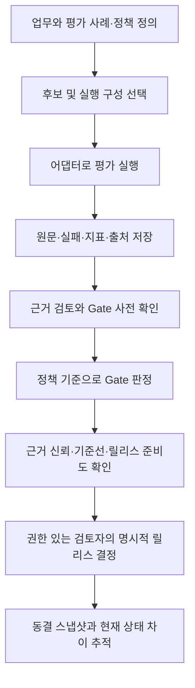
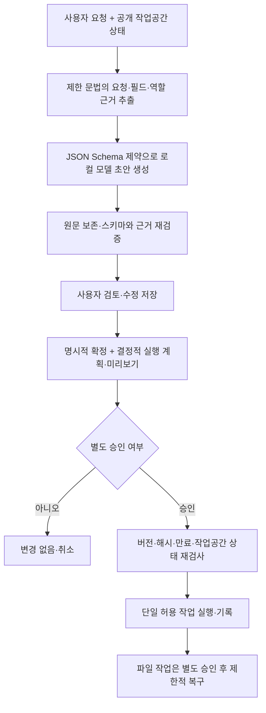

# Model Atlas 프로젝트 안내서

문서 기준일: 2026-10-17. 프로젝트를 처음 보는 사용자·평가자·기여자를 위한 현재 구조 안내다.
검증 수치는 별도로 적은 측정일의 결과이며, 문서 작성일에 새로 측정한 결과로 해석하지 않는다.

## 1. 우리가 만든 것

**Model Atlas는 로컬 LLM을 특정 업무에 도입해도 되는지 검토하고, 실제 사용 흐름까지 확인하는
로컬 중심 EvalOps 프로그램이다. 새로 학습한 LLM이나 모델 가중치 자체가 아니다.**

프로그램에는 두 흐름이 있다.

| 흐름 | 질문 | 제공하는 것 |
| --- | --- | --- |
| 모델 도입 평가 | 무엇을 테스트하고, 이 실행 구성을 사용해도 되는가? | 후보 비교, 평가 실행, 원문·지표·출처, 정책 판정, 릴리스 검토 |
| 개인 비서 검토 | 요청을 어떤 작업으로 해석했고, 실제로 실행해도 되는가? | 일정·할 일·파일 작업 초안, 수정·확정·미리보기·별도 승인·제한된 실행 |

두 흐름은 평가와 실제 사용이라는 목적에서 연결된다. 그러나 **추천 순위나 Gate 결과가 개인 비서
모델을 자동 교체하는 연결은 현재 없다.** 개인 비서의 검증된 경로는 `qwen3.5:9b`와
`assistant-release-v1`이며, 다른 모델을 적용하려면 어댑터·계약·회귀 검증을 다시 확인해야 한다.

## 2. 어떤 문제를 해결하려 했는가

로컬 모델 선택은 흔히 VRAM 적재 가능 여부, 토큰·컨텍스트 길이, 공개 벤치마크 평균에서 시작한다.
하지만 이 정보만으로는 다음 질문에 답하기 어렵다.

- 내 하드웨어·양자화·런타임·프롬프트 조합에서 실제 업무 요청도 올바르게 처리하는가?
- 평균 점수가 좋아도 중요한 사례 하나에서 위험한 동작을 제안하지는 않는가?
- 점수는 실제 실행 결과인가, 합성 데모인가? 누가 어떤 기준으로 평가했는가?
- 프롬프트나 모델을 바꿨을 때 이전보다 나빠진 부분과 당시 승인 근거를 추적할 수 있는가?
- JSON 형식이 맞더라도 날짜·우선순위·파일 대상의 의미가 틀리면 어떻게 막을 것인가?
- 사용자가 고쳐서 완료한 결과를 모델의 원래 정확도라고 잘못 계산하지 않는가?

그래서 **후보 선택 → 업무별 실측 → 근거와 정책 확인 → 명시적 결정**을 한 흐름으로 묶고,
개인 비서에서는 **모델의 제안과 실제 실행 권한을 분리**했다.

## 3. 사용자 유형

| 사용자 | 불편함 | 대표 행동 |
| --- | --- | --- |
| 로컬 LLM 도입 개발자 | 모델은 실행되지만 자기 업무에 맞는지 판단하기 어려움 | 업무 사례와 실행 구성을 등록하고 품질·속도·실패를 비교 |
| 개인 비서 사용자 | 일정·할 일·파일 정리를 자연어로 요청하되 실수를 확인하고 싶음 | 초안을 검토하고 수정·확정한 뒤 별도로 승인 |
| 릴리스 검토자 | 평균 점수나 데모만으로 도입 결정을 내리기 어려움 | critical 사례, 근거 출처, Gate, 동결 스냅샷을 확인 |
| 프로젝트 평가자·기여자 | 무엇이 구현됐고 무엇이 아직 실험인지 구분하기 어려움 | 격리 시연, 코드 책임, 검증 자료와 한계를 순서대로 확인 |

합성 페르소나는 자동 회귀 테스트에 사용한다. 실제 사용자 만족도 조사나 독립 인간 검토를
수행했다는 뜻은 아니다.

## 4. 하드웨어·토큰 중심 추천과의 차이

| 관점 | 하드웨어·토큰 중심 후보 추천 | Model Atlas가 추가하는 검토 |
| --- | --- | --- |
| 판단 단위 | 모델·크기·적재 가능성 중심 | 모델 아티팩트 + 런타임 + 하드웨어 + 프롬프트 + 생성 설정 + 업무·정책 버전 |
| 업무 적합성 | 선택한 제품의 기능과 보유 정보에 따라 다름 | 직접 구성한 사례의 원문·지표·실패·회귀를 기록 |
| 중요한 오류 | 전체 평균만으로는 가려질 수 있음 | critical 사례와 절대 정책 기준을 별도로 확인 |
| 근거 | 모델 사양이나 공개 점수가 출발점 | 실행 출처와 평가 점수의 출처를 분리하고 부족한 근거를 표시 |
| 변경 추적 | 제품별로 다름 | 프롬프트·평가·기준선·릴리스 스냅샷과 해시 연결 |
| 개인 비서 실행 | 추천 이후 사용은 별도 문제 | 초안과 사용자 수정, 실행 미리보기와 별도 승인을 구분 |

이는 특정 경쟁 제품보다 성능이 높다는 실험 결과가 아니다. 모든 추천 도구에 이 기능이 없다는
주장도 아니다. **사양으로 후보를 좁힌 다음, 업무별 근거와 도입 판단을 남기는 것**이 이 프로젝트의
차별점이다. 하드웨어 적재 가능성은 여전히 필요하며, Gate가 하드웨어 검사를 대체하지 않는다.

## 5. 전체 Flow

### A. 모델 도입 평가



후보 점수는 상대 비교이며 도입 승인이 아니다. Gate는 버전이 있는 정책 기준과 저장된 근거를
확인한다. 판정은 `APPROVED`, `CONDITIONAL`, `BLOCKED`, `INSUFFICIENT_EVIDENCE`로 나뉜다.
그 뒤에도 근거 신뢰도·Release Readiness·Production Readiness는 별도다.
**합성 데이터의 Gate 통과를 운영 적합성이나 사람의 배포 승인으로 승격하지 않는다.**

### B. 개인 비서 검토와 실행



모델이 `propose`를 반환해도 실행 권한을 얻지 않는다. `clarify`는 확인 요청, `refuse`는 거절,
`no_change`는 변경 없는 응답이다. 이 판정들의 원문 의미가 항상 검증된 것은 아니므로 화면의
요청 근거·문서 의미·설명 정책 상태를 별도로 읽어야 한다.

수정하면 기존 승인이 무효화된다. 승인은 5분 후 만료되고, 작업공간이 달라져도 새 미리보기가
필요하다. 재실행·복구도 버전과 상태를 확인하며, 무조건 재시도하거나 덮어쓰지 않는다.

## 6. 사용한 방법과 그 한계

| 방법 | 적용 내용 | 보장하지 않는 것 |
| --- | --- | --- |
| 업무·구성·정책 버전 관리 | 같은 모델 이름이어도 설정과 업무가 다르면 다른 검토 대상으로 취급 | 모든 조합의 품질 |
| 어댑터 기반 실행 | 평가 도구는 mock·OpenAI 호환 런타임 등을 분리, 개인 비서는 격리 Ollama 경로 사용 | 임의 모델의 무검증 교체 |
| 요청 근거 기반 구조화 생성 | 제한된 문법에서 확인한 필드·역할·값을 실제 디코딩 스키마에 연결 | 일반 자연어 이해 100% |
| 행동·내용·설명 근거 분리 | 실행 의도와 문서 내용의 의미, 최종 설명의 충분성을 구별 | 설명 형식이 맞으면 의미도 참이라는 주장 |
| 미검증 설명 제한 | 근거가 부족하면 확인·거절 등의 판정만 중립적으로 표시 | 미검증 의미를 새로 이해했다는 주장 |
| 결정적 실행 검증 | 시간대 변환, 중복·충돌, 경로·대상, 승인 상태를 코드로 재검사 | 잘못된 사용자 확정을 모두 탐지 |
| 해시·원문·감사 기록 | 요청, 구성, 원본 응답, 수정, 승인과 스냅샷을 추적 | 해시만으로 의미의 진실성이나 독립 서명을 인증 |
| 고정 회귀·재생·E2E | 원본 응답 정확도와 수정 후 성공, 실행 전 불변성을 나누어 확인 | 독립 blind 검증이나 실제 사용자 만족도 |

개인 비서의 기본 경로는 **기존 LLM + 제한된 규칙·스키마 + 검증기 + 사용자 승인**의 조합이다.
따라서 이 구성의 결과를 LLM 단독 성능이나 새 학습 기법의 성과라고 발표하지 않는다.
원본 모델 출력을 사후 정답으로 고치지 않으며, 평가의 비공개 정답이나 사용자 확정 값을
모델 입력에 넣어 정확도를 높였다고 계산하지 않는다.

RAG·도구 호출·반복 실행·bounded Agent 평가도 평가 도구에 있다. 다만 이들이 모두 개인 비서의
현재 경로에 자동 결합된 것은 아니다. 기본 RAG 검색·점수에는 결정적 로컬 평가 구성요소가
포함되며, 운영용 벡터 DB나 범용 자율 Agent를 구축했다고 주장하지 않는다.

## 7. 구성과 코드 책임

```text
Next.js / React UI
  -> FastAPI routes + Pydantic schemas
     -> EvalOps services -> inference adapters -> local runtime
        -> PostgreSQL: 실행 결과·지표·Gate·릴리스 기록
     -> Personal assistant review service -> release generation -> isolated Ollama
        -> SQLite + 전용 파일 디렉터리: 초안·승인·일정·할 일·파일 작업
```

PostgreSQL 평가 기록과 개인 비서의 SQLite 작업공간은 별개다. 프런트엔드는 모델을 직접 호출하지
않고 API를 사용한다. 실제 캘린더 계정이나 사용자 컴퓨터의 임의 폴더에 연결하지 않는다.

| 책임 | 코드 시작점 |
| --- | --- |
| 후보 점수·근거 | [recommendations.py](../backend/app/services/recommendations.py), [recommendation_evidence.py](../backend/app/services/recommendation_evidence.py) |
| 런타임 분리 | [inference_adapters](../backend/app/services/inference_adapters) |
| Gate 근거 수집·정책 평가 | [deployment_gate](../backend/app/services/deployment_gate) |
| 근거 신뢰 | [evidence_trust.py](../backend/app/services/evidence_trust.py) |
| 릴리스 준비·결정 | [release_readiness.py](../backend/app/services/release_readiness.py), [release_decisions.py](../backend/app/services/release_decisions.py) |
| API·사용자 작업공간 경계 | [personal_assistant.py](../backend/app/api/v1/routes/personal_assistant.py) |
| 현재 기본 초안 경로 | [release_generation.py](../backend/app/services/personal_assistant/release_generation.py) |
| 근거 추출·해석 한계 | [semantic_evidence.py](../backend/app/services/personal_assistant/semantic_evidence.py) |
| 닫힌 작업 계약·계획 | [contracts.py](../backend/app/services/personal_assistant/contracts.py), [planning.py](../backend/app/services/personal_assistant/planning.py) |
| 수정·확정·승인·버전 바인딩 | [reviews.py](../backend/app/services/personal_assistant/reviews.py) |
| 파일·실행·잠금·복구 | [sandbox.py](../backend/app/services/personal_assistant/sandbox.py), [service.py](../backend/app/services/personal_assistant/service.py), [recovery.py](../backend/app/services/personal_assistant/recovery.py) |
| 개인 비서 화면·API 계약 | [PersonalAssistantReview.tsx](../frontend/components/PersonalAssistantReview.tsx), [personalAssistant.ts](../frontend/lib/personalAssistant.ts) |
| 회귀와 재생 | [personal_assistant_release](../experiments/personal_assistant_release) |

Service Layer와 Adapter/Factory 등 기존 분리 방식을 사용한다. 여러 초안 전략은 명시적으로
선택하며 생성 실패를 숨기는 자동 대체 호출은 없다. 상태·감사 로그를 남긴다고 해서 전체 시스템을
Event Sourcing이나 분산 MLOps 플랫폼으로 구현한 것은 아니다.

## 8. 설치와 실행 선택

PowerShell, Docker Desktop, Node.js 22, Python 3.12 이상을 기준으로 한다. 전체 명령은
[1.0 설치 안내](releases/1.0.0/README.md)를 따른다. 두 실행 방식을 혼동하지 않는다.

| 목적 | 실행 방식 | UI / API |
| --- | --- | --- |
| EvalOps 핵심 흐름 시연 | `deploy/mvp-review.compose.yml`의 별도 프로젝트·새 DB | `localhost:13000` / `localhost:18010/api/v1` |
| 실제 모델 개인 비서 검토 | 호스트 API·웹 UI + `deploy/personal-assistant-eval.compose.yml`의 Ollama | `localhost:3000/personal-assistant` / `localhost:18000/api/v1` |

EvalOps 시연의 mock 결과는 실제 모델 품질 인증이 아니다. 기존 DB에 seed를 다시 실행하지 않는다.
개인 비서 작업공간도 새 이름으로 초기화한다. 포트가 사용 중이면 다른 포트를 지정하고 기존
프로세스나 데이터를 지우지 않는다. 모델 가중치·의존성·DB는 저장소와 검토 ZIP에 포함하지 않는다.

개인 비서의 검증 모델은 qwen3.5:9b Q4_K_M, context 8192, Ollama 0.31.1이다. 모델 digest는
`6488c96fa5faab64bb65cbd30d4289e20e6130ef535a93ef9a49f42eda893ea7`이다.
태그가 같아도 digest·런타임·하드웨어·설정이 다르면 같은 결과를 가정하지 않는다.
이 프로그램이 사용자 하드웨어 전체를 자동 최적화하거나 항상 가장 좋은 모델을 골랐다는 뜻은 아니다.

## 9. 개인 비서 사용법

1. 요청을 입력하고 **초안 생성**을 누른다. 이때 일정·할 일·파일은 아직 변경되지 않는다.
2. 원문과 폼을 비교한다. 작업 종류, 제목, 대상, 시각·시간대, 생략한 값이 맞는지 확인한다.
3. 필요한 값을 고치고 **수정 저장**을 누른다. 직접 수정한 결과는 모델의 원래 정답으로 계산하지 않는다.
4. 확인 체크 후 **확정 및 미리보기**를 누른다. 아직 실행하지 않으며 실제 실행 인자를 확인한다.
5. **승인하고 실행**을 누른다. 실행하지 않을 때는 취소한다. 충돌·만료·상태 변경이면 다시 검토한다.
6. 파일 작업을 되돌릴 때는 **복구 미리보기**를 보고 별도로 승인한다.

| 예시 | 확인할 내용 |
| --- | --- |
| `'정기 점검 알림'을 할 일로 추가해줘. priority=low.` | 제목과 low를 확인하고 별도 승인 후 추가 |
| `'정기 점검 알림'을 추가해줘. priority=low로 지정하면서 동시에 생략해줘. 우선순위는 정하지 않았어.` | 충돌을 임의로 정하지 않고 확인 요청, 변경 없음 |
| `2026년 12월 15일 뉴욕 현지 오전 8시 30분부터 45분간 '팀 회의' 일정을 잡아줘.` | `America/New_York`, 시작·길이, 미리보기의 변환 시각 확인 |
| `Inbox/review-demo.txt를 Archive/review-demo.txt로 옮겨줘.` | 샌드박스 안의 출발·목적 경로와 실행 후 별도 복구 |
| `../private.txt를 Archive/private.txt로 옮겨줘.` | 금지된 상위 경로, 실행 경계에서 거부 |

자연어 예시는 확인해야 할 의도를 보여준다. 모든 표현의 모델 정답을 보증하는 문구는 아니다.
할 일 완료는 화면에 있는 실제 ID나 유일한 제목을 확인한다. 우선순위는 `low/normal/high` 또는
생략이며, 생략과 `normal`은 다르다. 현지 시각에는 UTC offset을 붙이지 않고 IANA 시간대를
별도 지정한다. DST로 존재하지 않거나 중복되는 시각은 코드가 실행을 중단한다.

**원본 초안 근거**는 최초 모델 초안의 근거다. 수정한 필드의 의미까지 자동 인증하지 않는다.
미검증 표시는 실패를 숨긴 것이 아니라 자동 확인의 범위를 밝힌 것이다. 생성 오류의 원문도
보존하며 자동 재시도로 성공 응답을 골라내지 않는다.

파일 관리는 전용 작업공간의 이동·보관·복구다. 컴퓨터 전체 문서 내용 검색·자동 분류나
임의 명령 실행, 영구 삭제, Google Calendar·Todoist 연동은 현재 지원 범위가 아니다.

## 10. 평가 도구 사용법

1. 업무 프로필·평가 사례·정책을 확인한다. 정상 요청과 중요한 실패 사례를 함께 준비한다.
2. 모델 아티팩트·하드웨어·런타임·프롬프트·생성 설정을 묶어 실행 구성을 선택한다.
3. 평가를 실행하고 원문·실패·품질·속도·도구/RAG 지표와 출처를 확인한다.
4. Gate 사전 확인으로 근거 부족을 확인하고, 정책 평가 결과와 critical 실패를 검토한다.
5. 근거 신뢰, 기준선, 회귀, 릴리스 준비도를 별도로 읽고 명시적으로 결정한다.
6. 동결 스냅샷과 현재 상태의 차이를 확인한다. 과거 승인을 새 구성에 자동 적용하지 않는다.

기존 실패 모델이 `BLOCKED`로 보이는 것은 프로그램 오작동이 아니다. 시연 절차와 데이터의
범위는 [MVP 검토 안내](../MVP_REVIEW_GUIDE_KO.md)에 있으며, 그 문서의 과거 수치는 현재 성능으로
소급하지 않는다.

## 11. 무엇을 검증했는가

다음은 **2026-10-16 마감 측정**이다. 10월 17일 소스 재검증은
[PR 준비 기록](pull-requests/1.0-local-review.md), 원격 CI 상태는 GitHub PR Checks에서 별도로 확인한다.

| 근거 | 결과 | 해석 경계 |
| --- | --- | --- |
| 개인 비서 알려진 회귀 사례 | 164개 사례 × 2시드 = 328 관측 통과 | 새로운 blind holdout·일반 정확도 100% 아님 |
| 원문 재생 | 328건·추가 모델 호출 0·동결 소스 56개 확인 | 저장된 결과 재생이지 새 추론 328회 아님 |
| 실제 모델 브라우저 검증 | 21항목, 모델 요청 11개, 모델 출력 수정 0개 | 합성 작업공간의 자동 검증, 독립 사람 검토 아님 |
| 코드 테스트 | Windows 백엔드 1,261 통과·2 건너뜀, Linux 1,263 통과, 프런트 39 통과 | 프로그램의 회귀 근거, 모델의 일반화 증명 아님 |
| 의존성 감사 | npm 전체·실행 0건, Windows·Linux Python 각 50개 0건 | 당시 DB의 알려진 의존성 취약점, 보안 인증 아님 |

미검증 설명 68개는 34개 사례를 두 시드로 관측한 것이다. 실행 기능을 지원 범위 밖으로 밀어내
합격시킨 것이 아니라, 단정적인 원인 설명을 제한하고 의미 미검증 상태를 유지했다.
이를 새로 의미 이해에 성공한 68건으로 세지 않는다.

숫자는 [마감 집계](../artifacts/personal-assistant-release/2026-10-16/closeout-security-v1/verification.json),
[보안·검증 보고서](reports/2026-10-16_release_1_0_security_ko.md),
[공개 근거 범위](releases/1.0.0/EVIDENCE_INDEX_KO.md)에서 확인한다.

## 12. 완료와 미완료

완료한 것은 **설치·시연·검토 가능한 로컬 프로그램 1.0**이다. 새 LLM 학습, 운영 배포 적합성,
자율 실행 허용, 독립 사용자 평가가 완료됐다는 뜻은 아니다. 기존 평가의 BLOCKED와
`not_production_ready`, 외부 검토 pending은 실제 근거가 바뀔 때까지 유지한다.

OS·기본 이미지 전체 CVE 스캔, 침투 테스트, 외부 사람의 보안 검토는 별도다. 로컬 시연 스택을
인터넷에 노출하지 않는다. Next ESLint는 출처와 범위를 밝힌 로컬 패치를 사용하며, Next 업데이트
때 재검토해야 한다. Tailwind 4는 현대 브라우저를 대상으로 한다. [보안 경계](../SECURITY.md)를 따른다.

확장할 때는 평가 계약과 실행 계약을 먼저 정의하고 어댑터·검증·테스트를 추가한다. 기존 동결
실험이나 정답을 소급 수정하지 않는다. 현재 버전을 유지보수하는 기준은
[기여·확장 안내](../CONTRIBUTING.md), 자세한 개인 비서 내부 구조와 과거 채택 판단은
[개인 비서 기술 안내](personal_assistant_review_ko.md)를 따른다.
